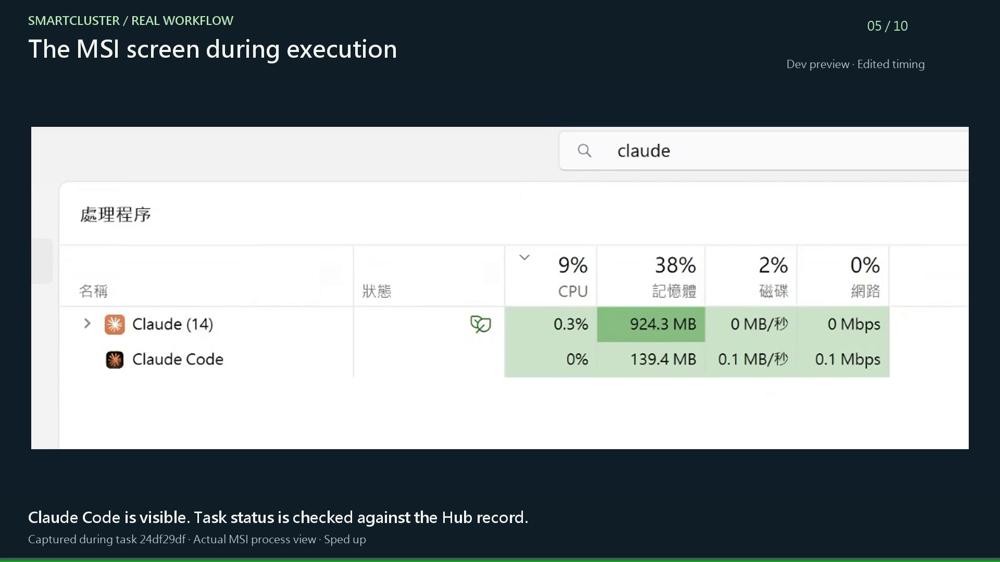

# Preview 2: from request to verifiable result

[Home](../README.md) · [繁體中文](DEMO.zh-TW.md) · [Live website](https://smartcluster.pages.dev/preview2/?lang=en#native-film) · [Offline introduction](../preview2/index.html?lang=en)

## See the Hub. Follow the agents. (120 seconds)

[Watch the English relay film](../preview2/media/smartcluster-native-demo.en.mp4) · [Captions](../preview2/media/smartcluster-native-demo.en.srt) · [繁體中文 video](../preview2/media/smartcluster-native-demo.zh-TW.mp4) · [Website](../preview2/index.html?lang=en#native-film)

Two $100 items with 20% off incorrectly total $199.80. Codex App delegates through SmartCluster. Gemini receives the job in Antigravity, reads the project, changes one formula and runs the existing five tests. The same Python checkout service returns $160.00. The official Claude CLI reviews this exact diff and test evidence, and the original Codex conversation receives the results.

One formal repair run: four failures before the fix, all five tests passing afterward, with the test-file hash unchanged. An independent rerun and the checkout API agree. Claude finds no must-fix issues for this change; input validation and monetary precision are out-of-scope suggestions. This is not acceptance of a complete commercial payment system.

This edition adds 36 seconds of real English Hub screenshots: the node map, provider details and a closing overview. These are user-provided captures showing their captured state, not a recording of this repair. Other visible nodes did not execute this case. The website also includes enlarged Hub screenshots.

The repair was run again with English task titles, English instructions and English results in the actual Antigravity App. English checkout-page stills and completed native tool history belong to this new run. Claude's official CLI review and returned results are presented as clearly marked editorial summaries, not a recreated App interface. Native approvals were performed by the user; waiting and approval screens are omitted.

Both editions share the same English demo visuals: choose English narration/captions or Traditional Chinese explanation. Each is 120 seconds, 1080p and 24 fps, with crops, neural narration (not human recordings) and original music. This local development demonstration is not a speed benchmark or acceptance of separate computers or the Python-free binary. Agents remain independently usable; SmartCluster adds optional coordination. The separate 60-second animation remains below.

## 60-second explanatory animation

[Watch the new English video](../preview2/media/smartcluster-preview2.en.mp4) · [Subtitles](../preview2/media/smartcluster-preview2.en.srt) · [繁體中文 video](../preview2/media/smartcluster-preview2.zh-TW.mp4)

The new, approximately one-minute motion-graphics introduction shows a SmartCluster workflow: choose an authorized node and agent, dispatch and execute, then inspect file changes, tests and reporting. This is **an explanatory animation, not a product screen recording**. The page's interactive illustration submits no real work. Native App waiting and approval requirements still apply.

Taiwan Mandarin and English versions include neural synthetic narration (not human recordings), on-screen captions and separate SRT/VTT captions. Narration uses natural pacing and pauses without accelerated speech.

dev5 adds moving task handoffs, message cues and a quiet original soundtrack that ducks under narration. Six chapter buttons seek without autoplay. Decorative page motion can be paused. Quick start provides practical guidance for three goals.

## Six ideas in the new introduction

1. Start with a clear request.
2. Let the Hub route work to an authorized computer.
3. Choose Codex, Claude, Gemini or a custom bridge according to capability.
4. Use a supported execution channel for file editing and tests.
5. Verify the result of the same task instead of treating submission as completion.
6. Understand Preview 2's supported scope before starting your own trial.

## What has live evidence?

The Primary development deployment has acceptance evidence for Gemini analysis/continuation, automatic desktop intake, file editing, five unittest cases and reporting; and for a CTE bridge isolated-worktree edit, unittest exit 0 and completion reporting. These summaries describe recorded results, not full capability acceptance of the new Windows binary. This package does not provide local isolated development or Gemini automatic-intake installation; a capable execution node is required. See the [release capability matrix](RELEASE_NOTES.en.md).

## Historical cross-computer recording (September 2026)

The following scene notes describe the earlier 60-second recording, separately from the Preview 2 animation. It is not acceptance of the new package.

[Watch the English-captioned demo](../media/SmartCluster-MSI-demo-v3.en.mp4) · [Subtitles](../media/SmartCluster-MSI-demo-v3.en.srt)

In this real recorded workflow, a user asks an agent on Mac mini M4 to send a text review to Claude on MSI. SmartCluster carries the supported task through MCP, the target's official CLI performs the analysis, and the initiating conversation retrieves the result. The Hub provides the task record used to check the execution node and completion.

## Follow the 60-second story

| Time | What you see | Why it matters |
|---|---|---|
| 0–6 s | Hub node graph: five online nodes | Discover the available network. This task involves the Mac and MSI; it does not use all five nodes. |
| 6–10 s | A prior MCP node query in the lead conversation | Ask about available computers from chat. This short query clip precedes the new task. |
| 10–20 s | A request to review the fictional Orbit pitch | Give the target a concrete task and request three recommendations. |
| 20–37 s | MSI desktop and Windows Task Manager | See the target computer during the task. Process names and activity alone do not identify or prove completion of a specific task. |
| 37–45 s | The lead conversation retrieves the review | Bring the result back to the user, without manually copying it from the target. |
| 45–56 s | Hub completion and history | Check the recorded initiator, execution node, outcome, and delivery. |
| 56–60 s | Closing view | Delegate in chat and follow the outcome. |

## Try a comparable workflow

First follow the setup guide, connect MCP to the intended profile, and complete a no-AI diagnostic. Enable and sign in to the intended AI provider on the target. Use your own node name in these requests:

> List this group's nodes and enabled AI providers. Identify Windows Test Node and report its readiness.

> Ask Claude on Windows Test Node to review the following fictional product pitch for clarity and unsupported claims. Return a short review and three recommendations. Do not modify files. Track the task to its final state and include its task ID: [insert sample text].

> Retrieve the final result for that task. If it failed or remains queued, report the actual state instead of assuming success.

The target owner controls provider access and account allowance. A successful diagnostic tests connectivity; it does not establish AI readiness. Tools available to a task depend on its configured execution path and permissions.

## What this film does and does not establish

Both language editions are 60-second, 1080p, 30 fps recordings with edited timing, titles, captions, and original synthesized background music. They have no spoken narration. Some original operating-system labels remain in Chinese. The English edition is an English-captioned edition, not a completely English operating-system session.

The MSI footage shows a process view. It does not show Claude's live chat or terminal output, and no PID-to-task mapping was captured. Task attribution comes from the Hub record. Cuts and accelerated segments are not a performance benchmark or a continuous live session. Orbit is fictional demonstration content.

Visible execution output is planned for the [next phase](ROADMAP.en.md). The film is a demonstration of a development environment; it does not establish public macOS binary availability or release acceptance of every displayed node or network path.
