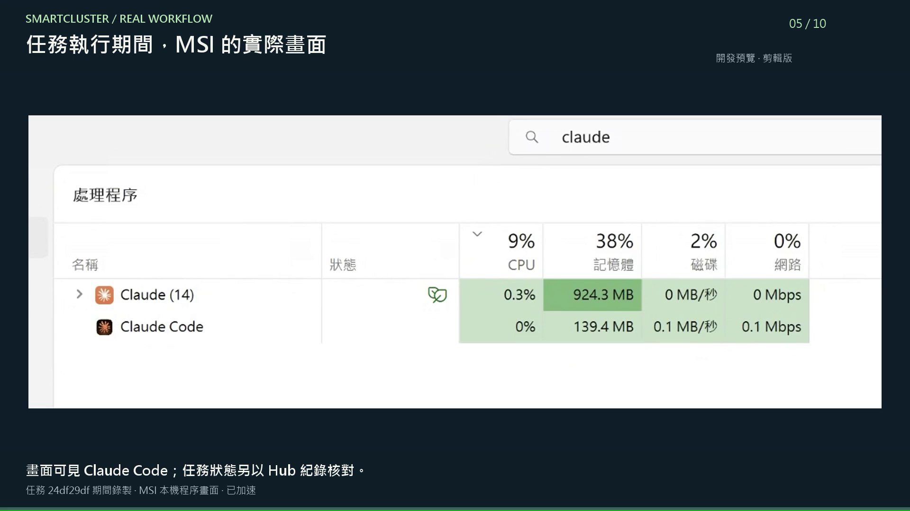

# Preview 2：從要求到可查驗的結果

[首頁](../README.zh-TW.md) · [English](DEMO.en.md) · [線上介紹網站](https://smartcluster.pages.dev/preview2/?lang=zh-TW#native-film) · [離線介紹](../preview2/index.html?lang=zh-TW)

## 看見 Hub，也看見 Agent 開工（120 秒）

[觀看中文接力實拍](../preview2/media/smartcluster-native-demo.zh-TW.mp4) · [字幕](../preview2/media/smartcluster-native-demo.zh-TW.srt) · [English video](../preview2/media/smartcluster-native-demo.en.mp4) · [網站入口](../preview2/index.html?lang=zh-TW#native-film)

兩件各 100 元的商品打八折，結帳卻算成 199.80。在 Codex App 透過 SmartCluster 派給 Gemini，Antigravity 原生 App 自動收件、讀檔、修改一行公式並跑原有五項測試；同一個 Python 結帳服務回傳 160.00。接著 Claude 官方 CLI 審查這次差異與測試證據，結果回到原本的 Codex 對話。

本片只有一個正式修復案例：修正前五項測試有四項失敗，修正後五項通過，測試檔雜湊未變；獨立重跑及結帳 API 也一致。Claude 確認本次修復無必修問題，並指出輸入驗證與金額精度屬範圍外建議。這不代表完整商用金流已驗收。

新版加入 36 秒真實英文 Hub 截圖：節點地圖、Agent 能力與結尾總覽。來源是使用者提供的擷取畫面，呈現擷取當時狀態，並非本次修復的即時錄影；其他可見節點沒有執行本案例。網站也加入可放大的 Hub 截圖。

修復流程已重新執行，採用英文任務名稱、指令與回報，錄製真正的 Antigravity App。英文結帳頁截圖及完成後查看的原生工具紀錄來自本次新案例。Claude 官方 CLI 審查與回傳成果使用明確標示的編輯摘要，不仿造 App 介面。原生核准由使用者操作，等待與核准畫面已剪除。

中英文版共用英文範例畫面，可選英文旁白／字幕或繁體中文解說；各 120 秒、1080p、24 fps，含裁切、神經合成旁白（非真人錄音）及原創配樂。這是本機開發部署示範，片長不是執行速度，不代表跨實體機或免 Python 執行檔驗收。Agent 仍可獨立使用，SmartCluster 提供選用的任務協調。以下保留另一支 60 秒解說動畫。

## 60 秒解說動畫

[觀看新版中文影片](../preview2/media/smartcluster-preview2.zh-TW.mp4) · [字幕](../preview2/media/smartcluster-preview2.zh-TW.srt) · [English video](../preview2/media/smartcluster-preview2.en.mp4)

新版以約一分鐘動態圖形介紹 SmartCluster：選擇已授權的節點與 Agent，派工、執行，再核對檔案差異、測試與回報。影片是**流程解說，不是產品操作錄屏**；網頁的互動示意也不會提交真實工作。原生 App 的等待與核准沒有因剪輯或示意而消失。

新版含台灣華語及英文神經合成旁白（非真人錄音）、畫面字幕與可獨立開啟的 SRT／VTT 字幕。保留自然語速與句間停頓，沒有以加速方式硬塞旁白。

dev5 新增任務接棒動態、訊息提示及低音量原創配樂；配樂會在旁白出現時降低。網頁六個章節按鈕只定位，不自動播放；可暫停首頁動態。快速開始區提供三種目標的實際操作指引。

## 新版介紹的六個重點

1. 從一個清楚的要求開始。
2. 讓 Hub 把工作交給已授權的電腦。
3. 依能力選 Codex、Claude、Gemini 或自有 bridge。
4. 透過支援的執行通道完成寫檔與測試。
5. 依同一任務核對結果，而非只看「已提交」。
6. 了解 Preview 2 的支援範圍，再開始自己的測試。

## 哪些部分已有實機依據？

Primary 開發部署已驗收 Gemini 的分析／續接、桌面自動收件、寫檔、5 項 unittest 與回報，以及 CTE bridge 在隔離工作樹修正檔案、執行 unittest exit 0 並回報完成。這些摘要描述已記錄結果，不能當成新 Windows 執行檔已具備全部能力。本包不提供本機隔離開發及 Gemini 自動收件安裝；必須搭配符合條件的執行節點。詳見[版本能力矩陣](RELEASE_NOTES.zh-TW.md)。

## 歷史跨機實錄（2026 年 9 月）

以下保留較早 60 秒錄影片的逐段說明，與 Preview 2 動態介紹分開辨識；它不是新版套件驗收。

[觀看中文字幕版](../media/SmartCluster-MSI-demo-v3.zh-TW.mp4) · [獨立字幕](../media/SmartCluster-MSI-demo-v3.zh-TW.srt)

這段實錄中，使用者在 Mac mini M4 的 Agent 對話請 MSI 上的 Claude 審閱文字。SmartCluster 透過 MCP 提交支援的任務，由目標電腦的官方 CLI 分析，再由發起對話取回結果。Hub 的任務紀錄提供執行節點及完成狀態的查驗依據。

## 60 秒逐段解說

| 時間 | 畫面 | 帶來的價值 |
|---|---|---|
| 0–6 秒 | Hub 節點圖：五個在線節點 | 掌握可用網路；本次只有 Mac 與 MSI 參與任務，不是五台一起執行。 |
| 6–10 秒 | 主對話透過 MCP 查節點的先前片段 | 在對話中查詢可用電腦；這個短片段早於後續新任務。 |
| 10–20 秒 | 輸入審閱虛構 Orbit 文案的要求 | 指定目標及具體工作，要求回傳三點建議。 |
| 20–37 秒 | MSI 桌面與 Windows 工作管理員 | 看見任務期間的目標電腦；程序名稱或活動本身不能證明某項任務身分或完成。 |
| 37–45 秒 | 主對話取回審閱結果 | 結果回到發起處，不需手動到目標電腦複製。 |
| 45–56 秒 | Hub 完成紀錄與歷史 | 核對發起端、執行節點、結果與交付。 |
| 56–60 秒 | 結尾 | 從對話派工，追蹤實際結果。 |

## 自己試一次

先依設定手冊連接正確 profile 的 MCP，完成不使用 AI 的診斷，再於目標電腦啟用及登入指定 AI provider。以下節點名稱請換成你的實際名稱：

> 請列出目前群組的節點與已啟用 AI provider，找出 Windows Test Node 並回報是否可接工作。

> 請讓 Windows Test Node 上的 Claude 審閱以下虛構產品文案，檢查清晰度及缺乏依據的宣稱，回傳短評與三點建議。不要修改檔案。追蹤至最終狀態並附任務 ID：[貼上範例文字]。

> 請取回該任務的最終結果；若失敗或仍排隊，回報實際狀態，不要假設已完成。

目標電腦的擁有者控制 provider 權限及帳號額度。診斷成功只代表連線測試通過，不等於 AI 已可用；任務可用工具取決於執行方式及既有授權。

## 展示範圍

中英文各 60 秒、1080p、30 fps，包含剪輯、標題、字幕與原創合成背景音樂，沒有口語旁白。來源作業系統部分文字仍為中文；英文版指英文標題及字幕版，不是全英文作業系統錄影。

MSI 畫面是程序檢視，沒有錄到 Claude 的即時對話或終端輸出，也沒有捕捉 PID 與任務的對照；任務歸屬以 Hub 紀錄查驗。剪接及加速片段不是效能測試，也不是不中斷的直播。Orbit 為虛構展示文案。

可見執行輸出列入[下一階段](ROADMAP.zh-TW.md)。本片展示開發環境，不代表已有公開 macOS 執行檔，也不代表畫面中所有節點及網路路徑均完成發佈驗收。
